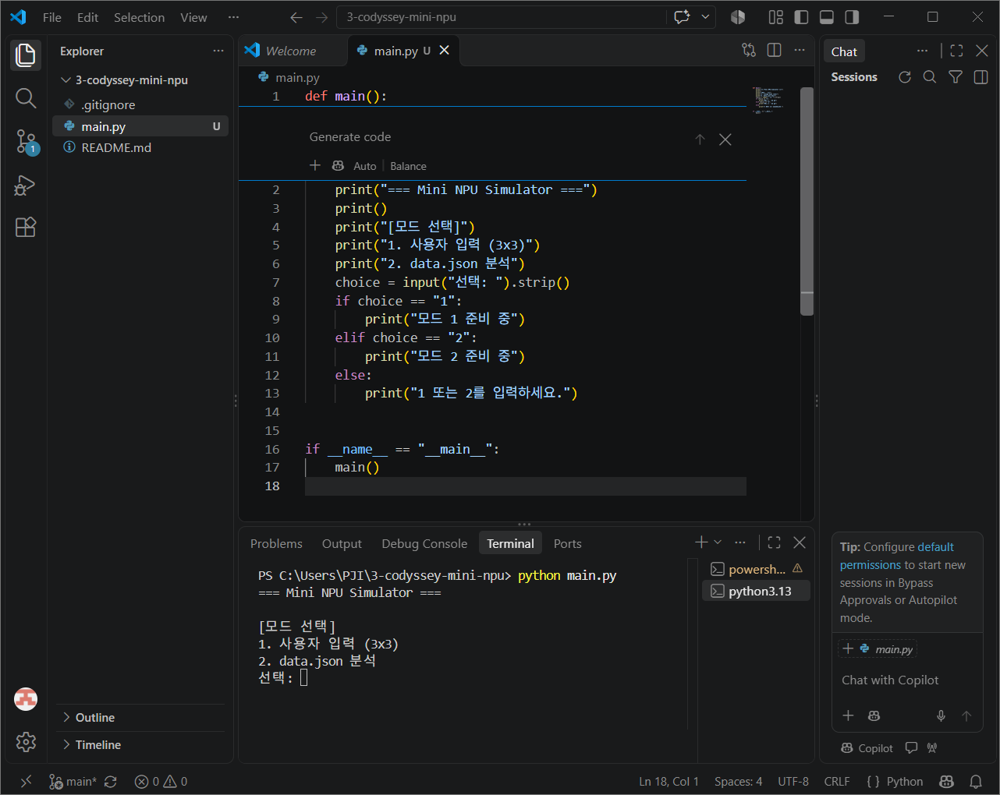
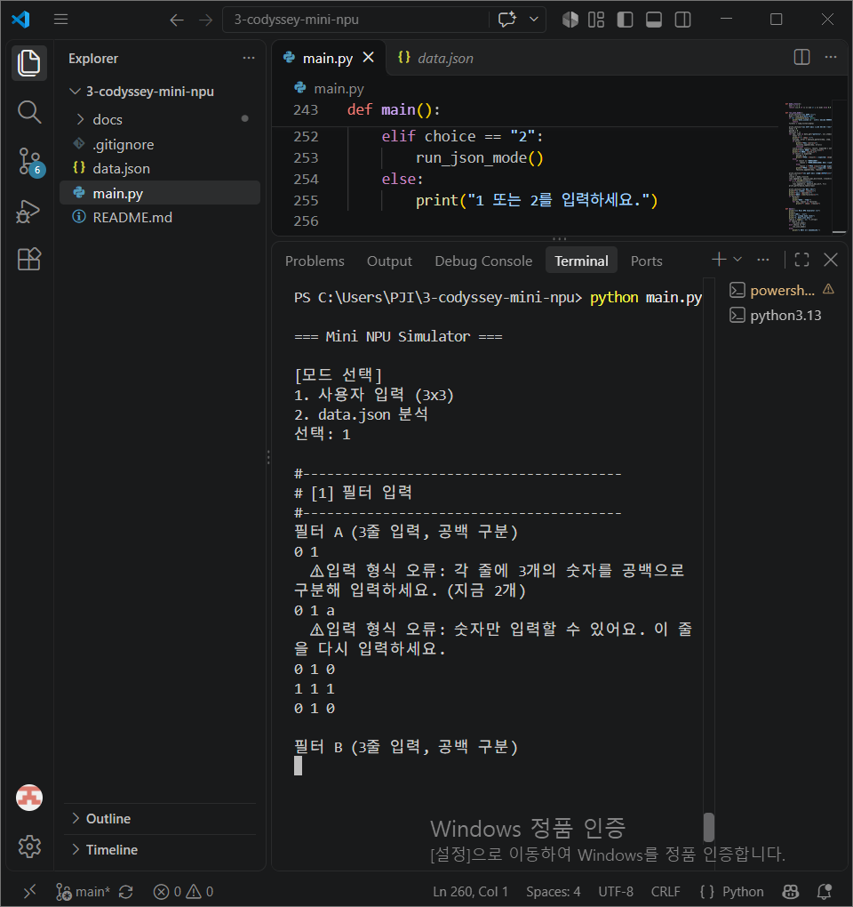
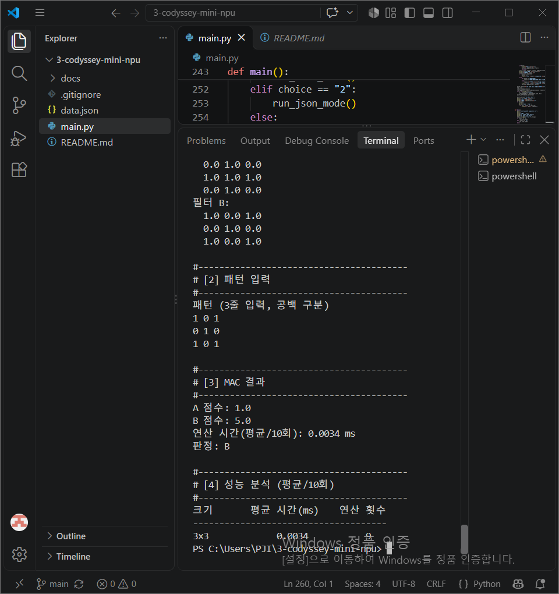
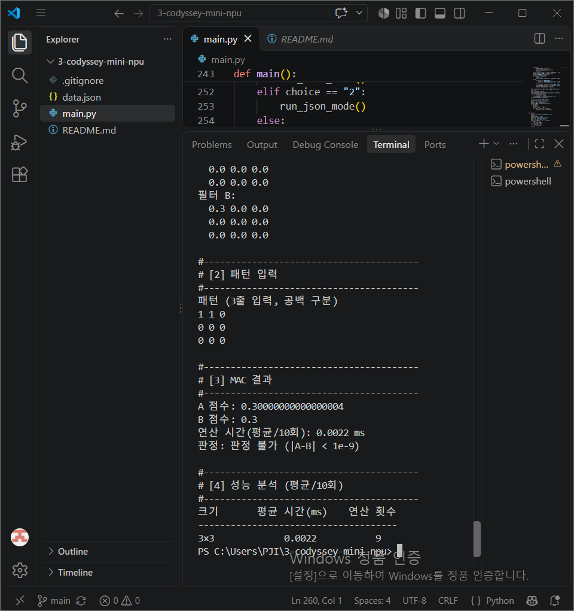
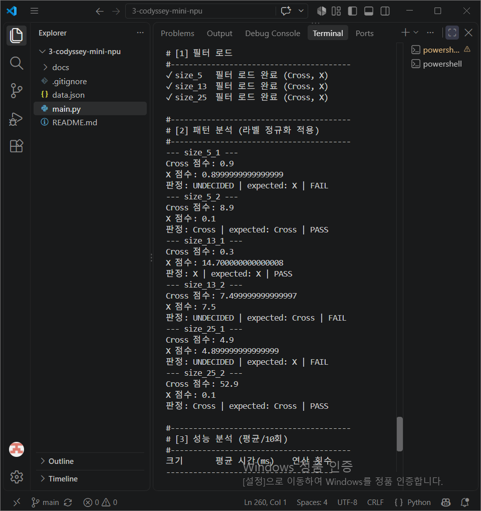
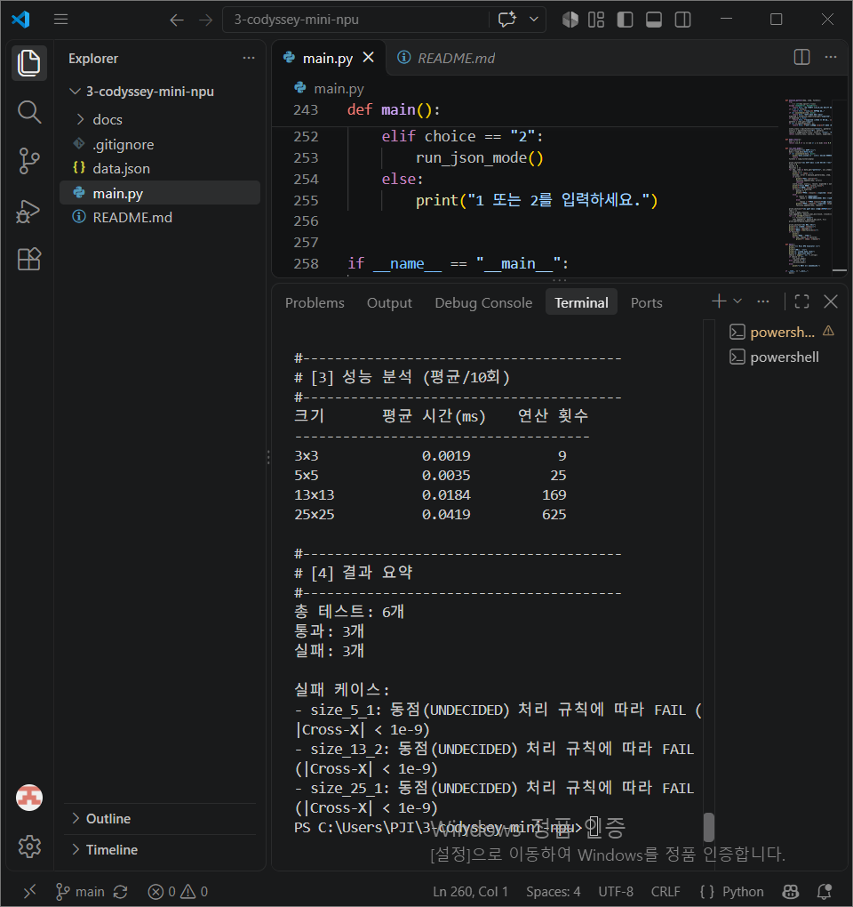

# Mini NPU Simulator (코디세이 미션3)

필터와 패턴을 같은 칸끼리 곱하고 더하는 **MAC(Multiply-Accumulate) 연산**으로 그림이 십자가(Cross)인지 X인지 판정하는 Python 콘솔 프로그램입니다. 3×3부터 25×25까지 크기별 연산 시간도 측정합니다.

## 1. 실행 방법

```bash
python main.py
```

- Python 3.8 이상, 표준 라이브러리(json, os, time)만 사용합니다. 외부 라이브러리는 쓰지 않습니다.
- 실행하면 모드를 고릅니다.
  - `1` 사용자 입력 (3×3): 필터 A, 필터 B, 패턴을 한 줄씩(공백 구분) 입력
  - `2` data.json 분석: 저장된 필터와 패턴을 읽어 일괄 판정
- `data.json`은 `main.py`와 **같은 폴더**에 있어야 합니다. 코드가 main.py 위치를 기준으로 찾기 때문에, 다른 폴더에서 실행해도 읽을 수 있습니다.

### 파일 구조

```
3-codyssey-mini-npu/
├── main.py              # 메인 실행 파일
├── data.json            # 모드 2 입력 데이터 (필터 + 패턴 + 정답)
├── README.md
└── docs/screenshots/    # 실행 화면 캡처
```

## 2. 구현 요약

### 데이터 구조
- 필터와 패턴은 **2차원 리스트**(`list[list[float]]`)로 저장합니다. `grid[i][j]`로 i번째 줄 j번째 칸의 값을 읽습니다.
- 3×3, 5×5, 13×13, 25×25를 같은 함수로 처리합니다. 크기는 `len(grid)`로 정해집니다.

### MAC 연산 (`mac`)
- 이중 반복문으로 모든 칸을 돌며 `filter[i][j] * pattern[i][j]`를 `total`에 더합니다.
- NumPy 같은 벡터화 라이브러리 없이 반복문으로 직접 구현했습니다.
- N×N이면 곱셈과 덧셈을 정확히 N²번 합니다.

### 라벨 정규화 (`normalize_label`)
data.json 안에서는 같은 뜻의 라벨이 다르게 적혀 있습니다.

| 원래 값 | 위치 | 표준 라벨 |
|---|---|---|
| `+` | patterns의 expected | Cross |
| `x` | patterns의 expected | X |
| `cross` | filters의 키 | Cross |
| `x` | filters의 키 | X |

- 앞뒤 공백을 지우고 소문자로 바꾼 뒤 `LABEL_MAP` 표에서 찾습니다. 그래서 `X`, ` x ` 처럼 대소문자나 공백이 달라도 같은 라벨이 됩니다.
- 표에 없는 라벨은 `None`이 되어, 그 케이스를 "expected 라벨을 알 수 없음"으로 FAIL 처리합니다.
- 화면 출력과 PASS/FAIL 비교는 모두 표준 라벨(Cross/X)로 합니다.

### 동점 처리 정책 (epsilon, `judge`)
- `abs(score_a - score_b) < 1e-9` 이면 동점으로 보고 **UNDECIDED**(모드 1에서는 "판정 불가")로 판정합니다.
- 동점이 아니면 점수가 큰 쪽으로 판정합니다.
- `==`로 비교하지 않는 이유: 컴퓨터는 0.1 같은 소수를 2진수로 정확히 저장하지 못해 `0.1 + 0.2`가 `0.30000000000000004`가 됩니다. 수학적으로 같은 점수인데 아주 작은 오차 때문에 한쪽이 이긴 것처럼 보이는 일을 막기 위해 허용오차를 둡니다.

### 입력 검증과 예외 처리
- **모드 1** (`read_matrix`): 한 줄에 숫자가 3개가 아니거나, 숫자로 바꿀 수 없는 글자가 있으면 "입력 형식 오류" 안내를 출력하고 **그 줄만 다시** 입력받습니다.
- **모드 2**: 문제가 있어도 프로그램이 멈추지 않고 **그 케이스만 FAIL**로 기록하고 다음 케이스로 넘어갑니다.
  - 키가 `size_N_idx` 형식이 아님 / 해당 크기 필터 없음 / expected 라벨을 모름 / 패턴이 N×N이 아님(필터와 크기 불일치)
  - data.json 파일이 없거나 JSON 형식이 깨졌으면 안내 문구를 출력하고 분석을 멈춥니다(프로그램 오류로 죽지 않음).
- 패턴 키 `size_13_2`에서 `_`로 나눈 두 번째 값 `13`을 꺼내 `size_13` 필터를 고릅니다.

### 시간 측정 (`measure_mac_ms`)
- `time.perf_counter()`로 **`mac()` 호출 앞뒤만** 잽니다. 입력, 화면 출력, 파일 읽기 시간은 포함하지 않습니다.
- 크기마다 10회 반복해서 평균(ms)을 냅니다.
- 3×3은 data.json에 없으므로 코드에서 3×3 십자가(`make_cross(3)`)를 만들어 측정합니다.

## 3. 결과 리포트

### 3-1. 모드 2 결과 요약

| 케이스 | Cross 점수 | X 점수 | 판정 | expected | 결과 |
|---|---|---|---|---|---|
| size_5_1 | 0.9 | 0.8999999999999999 | UNDECIDED | X | FAIL |
| size_5_2 | 8.9 | 0.1 | Cross | Cross | PASS |
| size_13_1 | 0.3 | 14.700000000000008 | X | X | PASS |
| size_13_2 | 7.499999999999997 | 7.5 | UNDECIDED | Cross | FAIL |
| size_25_1 | 4.9 | 4.899999999999999 | UNDECIDED | X | FAIL |
| size_25_2 | 52.9 | 0.1 | Cross | Cross | PASS |

**총 6개 / 통과 3개 / 실패 3개**

### 3-2. FAIL 케이스 원인 분석

실패 원인을 "데이터/스키마 문제 → 로직 문제 → 수치 비교 문제" 순서로 하나씩 확인했습니다.

1. **데이터/스키마 문제가 아님:** 3개 케이스 모두 키 형식(`size_N_idx`), 필터 존재, 패턴 크기(N×N), expected 라벨 정규화를 정상 통과했습니다. 스키마 오류였다면 점수가 출력되지 않고 오류 사유가 표시됩니다.
2. **MAC 로직 문제가 아님:** 같은 `mac()` 함수로 계산한 나머지 3개 케이스는 모두 PASS였고, 모드 1에서 과제 예시(십자가 필터 1.0 / X 필터 5.0)도 정확히 나왔습니다.
3. **원인은 수치 비교(동점) 문제입니다.** 세 케이스 모두 두 점수가 수학적으로는 같습니다.
   - size_5_1: Cross 필터는 패턴과 가운데 칸(0.9)만 겹쳐 0.9, X 필터는 0.1인 9칸이 겹쳐 0.1×9 = 0.9
   - size_13_2: Cross 필터는 0.3인 25칸이 겹쳐 0.3×25 = 7.5, X 필터는 가운데 7.5 한 칸만 겹쳐 7.5
   - size_25_1: Cross 필터는 가운데 4.9만 겹쳐 4.9, X 필터는 0.1인 49칸이 겹쳐 0.1×49 = 4.9
4. 그런데 0.1, 0.3 같은 소수를 여러 번 더하면 부동소수점 오차가 쌓여서 `0.8999999999999999`, `7.499999999999997` 같은 값이 됩니다. 차이는 1e-15 수준입니다.
5. 만약 `>`로 그냥 비교했다면 이 아주 작은 오차 때문에 size_5_1은 Cross, size_13_2는 X로 판정되어, **"우연히 이긴 쪽"을 정답처럼 보이게** 했을 것입니다. 이것은 진짜 판정이 아니라 계산 오차에 따른 결과입니다.
6. epsilon(1e-9) 정책은 이런 경우를 "판정 불가(UNDECIDED)"로 정직하게 표시합니다. UNDECIDED는 Cross도 X도 아니므로 expected와 달라 FAIL이 됩니다.
7. 따라서 이 3개의 FAIL은 프로그램 버그가 아니라, **필터 가중치가 두 모양에 같은 점수를 주도록 설계된 데이터**를 epsilon 정책이 올바르게 걸러낸 결과입니다.
8. 개선 방향: 필터 가중치를 조정해 두 필터 점수가 확실히 벌어지게 하거나, 동점일 때 쓸 별도 규칙(예: 더 많은 칸이 겹친 쪽 우선)을 정하면 PASS로 바꿀 수 있습니다. 다만 과제의 동점 규칙을 지키기 위해 이번 구현에서는 바꾸지 않았습니다.

### 3-3. 성능 분석 (평균/10회, 내 컴퓨터 기준)

| 크기(N×N) | 평균 시간(ms) | 연산 횟수(N²) |
|---|---|---|
| 3×3 | 0.0019 | 9 |
| 5×5 | 0.0035 | 25 |
| 13×13 | 0.0184 | 169 |
| 25×25 | 0.0419 | 625 |

### 3-4. 시간 복잡도 분석: O(N²)

1. `mac()`은 줄(N개) × 칸(N개)을 도는 이중 반복문이라, 곱셈·덧셈을 정확히 **N²번** 합니다. 그래서 이론상 시간 복잡도는 **O(N²)**, 즉 그림의 넓이(칸 수)에 비례합니다.
2. 측정 결과도 크기가 커질수록 시간이 함께 늘었습니다. 연산 횟수가 9 → 25 → 169 → 625로 늘 때, 시간도 0.0019 → 0.0035 → 0.0184 → 0.0419 ms로 계속 늘었습니다.
3. 5×5 → 13×13: 연산 횟수는 약 6.8배(25 → 169), 시간은 약 5.3배(0.0035 → 0.0184) 늘었습니다.
4. 5×5 → 25×25: 연산 횟수는 25배(25 → 625), 시간은 약 12배(0.0035 → 0.0419) 늘었습니다.
5. 시간이 연산 횟수만큼 딱 맞게 늘지 않는 이유는 **고정 비용** 때문입니다. 함수 호출, 변수 준비, 반복문 시작처럼 크기와 상관없이 매번 드는 시간이 있는데, 작은 크기에서는 이 고정 비용이 전체 시간의 큰 부분을 차지합니다.
6. 실제로 3×3과 5×5는 연산 횟수가 약 2.8배 차이인데 시간은 약 1.8배 차이로, 고정 비용의 영향이 가장 크게 보입니다.
7. 크기가 커질수록 칸 수에 비례하는 부분이 고정 비용보다 훨씬 커지므로, 큰 크기로 갈수록 "넓이에 비례"하는 모양에 가까워집니다.
8. 또 측정 시간이 0.01ms 단위로 매우 짧아서, 그 순간 다른 프로그램이 CPU를 쓰면 값이 흔들릴 수 있습니다. 그래서 10회 평균을 냈고, 실행할 때마다 숫자는 조금씩 달라질 수 있습니다.
9. 이 결과로 예측해 보면, 한 변이 4배인 100×100(10,000칸)은 25×25보다 칸이 16배 많으므로 약 0.0419 × 16 ≈ 0.67ms 안팎이 걸릴 것으로 예상할 수 있습니다.
10. 실제 AI는 수백×수백 크기 필터를 수천 개씩 쓰기 때문에 N²으로 늘어나는 연산량을 감당하기 어렵습니다. 그래서 수많은 MAC을 동시에 처리하는 NPU 같은 전용 칩이 필요합니다.

## 4. 실행 화면

| 메뉴 | 입력 오류 → 재입력 |
|---|---|
|  |  |

| 모드 1: 과제 예시 (판정 B) | 모드 1: 판정 불가 (epsilon) |
|---|---|
|  |  |

| 모드 2: 필터 로드 + 패턴 분석 | 모드 2: 성능 표 + 결과 요약 |
|---|---|
|  |  |

## 5. 개발 환경

- Windows, PowerShell, VS Code
- Python 3.13 (요구 조건 3.8 이상)
- 외부 라이브러리 없음 (json, os, time 표준 라이브러리만 사용)
